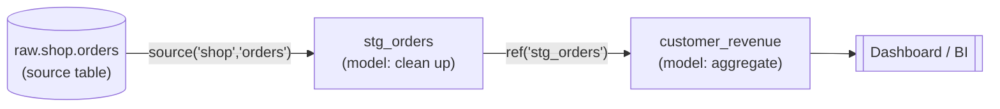

# dbt Model: A Basic Example (One Source Table)

## What is a dbt model?

A **dbt model** is one transformation step, saved as a file, that produces one table or view in your warehouse.

- **A file**: e.g. `stg_orders.sql`
- **The logic inside it**: a `SELECT` that describes what the data should look like
- **The output it creates**: a table/view called `stg_orders` in the warehouse

You write only the `SELECT`. dbt handles the `CREATE VIEW` / `CREATE TABLE`, the run order, testing, and docs.

---

## The flow



```
raw.shop.orders  →  stg_orders  →  customer_revenue
   (source)          (model 1)        (model 2)
```

---

## 1. The raw table (already loaded in your warehouse)

`raw.shop.orders`

| id | cust_id | amt_cents | status    | created    |
|----|---------|-----------|-----------|------------|
| 1  | 101     | 2500      | COMPLETED | 2026-10-01 |
| 2  | 102     | 1000      | cancelled | 2026-10-02 |
| 3  | 101     | 4000      | completed | 2026-10-03 |

Problems: unclear column names, amounts stored in cents, inconsistent status capitalization.

---

## 2. Tell dbt the source exists

`models/sources.yml`

```yaml
version: 2

sources:
  - name: shop          # a name you choose for the source
    database: raw
    schema: shop
    tables:
      - name: orders
```

---

## 3. Write the model

`models/stg_orders.sql`

```sql
select
    id                  as order_id,
    cust_id             as customer_id,
    amt_cents / 100.0   as amount,
    lower(status)       as status,
    created             as order_date
from {{ source('shop', 'orders') }}
```

That's the whole model: a `SELECT` that cleans the raw table.

---

## 4. Run it

```bash
dbt run
```

dbt turns the model into SQL like this and runs it:

```sql
create view analytics.stg_orders as (
    select id as order_id, ...
    from raw.shop.orders
);
```

---

## 5. The result

A new view, `analytics.stg_orders`:

| order_id | customer_id | amount | status    | order_date |
|----------|-------------|--------|-----------|------------|
| 1        | 101         | 25.00  | completed | 2026-10-01 |
| 2        | 102         | 10.00  | cancelled | 2026-10-02 |
| 3        | 101         | 40.00  | completed | 2026-10-03 |

The raw table stays untouched, and now there's a clean version for everyone to use.

---

## 6. A second model that builds on the first

`models/customer_revenue.sql`

```sql
select
    customer_id,
    count(*)     as completed_orders,
    sum(amount)  as total_revenue
from {{ ref('stg_orders') }}
where status = 'completed'
group by customer_id
```

Result:

| customer_id | completed_orders | total_revenue |
|-------------|------------------|---------------|
| 101         | 2                | 65.00         |

Because of `ref('stg_orders')`, dbt knows to build `stg_orders` first, then `customer_revenue`.

---

## Key takeaways

| You do                        | dbt does                                        |
|-------------------------------|-------------------------------------------------|
| Write a `SELECT`              | Creates or replaces the table/view for you      |
| Use `source()` / `ref()`      | Works out the run order (the DAG)               |
| Split logic into small files  | Chains them together like functions             |
| Add tests/descriptions in YAML| Checks the data and generates docs + lineage    |
